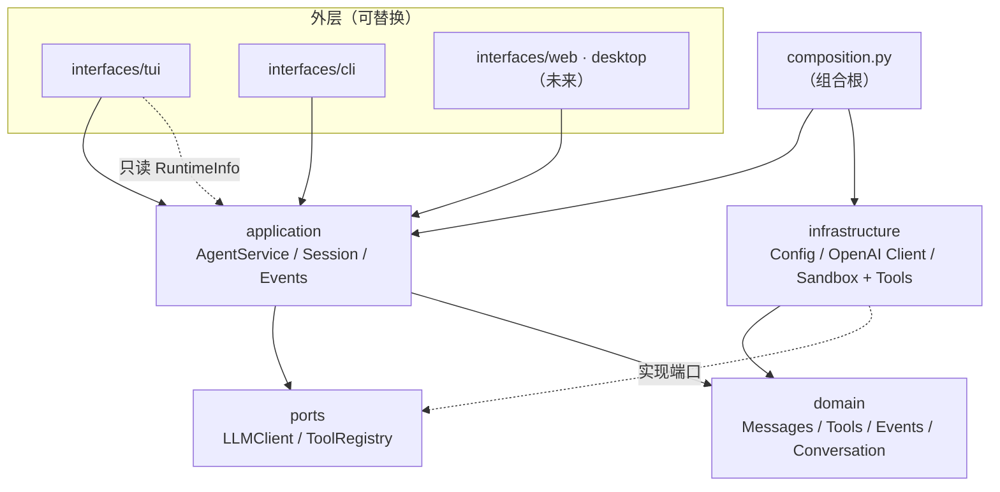
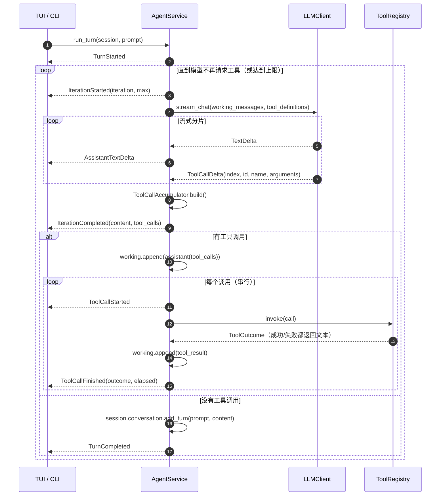
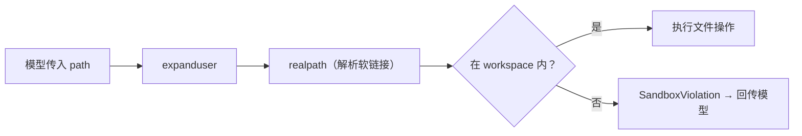

# xAgent 架构说明

本文回答三个问题：

1. 代码为什么这样分层？
2. 一轮对话在层与层之间如何流动？
3. 新增工具 / 模型厂商 / 界面时，应该改哪里、不该改哪里？

---

## 1. 设计目标

| 目标 | 落地方式 |
| --- | --- |
| core 与 UI 分离 | `application.AgentService` 只产出事件，不 import 任何 UI |
| 界面可替换 | TUI、CLI 都是 `AgentEvent` 的消费者；契约见 `application/events.py` |
| 模型厂商可替换 | `ports.llm.LLMClient` Protocol + 基础设施实现 |
| 工具可插拔 | `ports.tools.ToolRegistry` + `infrastructure/tools/catalog.py` |
| 可测试 | 领域纯函数、Fake LLM、Fake Registry、无头 TUI |
| 安全 | 路径沙箱、破坏性操作确认、轮数上限、输出截断 |
| 架构可持续 | `tests/test_layering.py` 用 AST 强制依赖方向 |

非目标（当前版本）：多会话持久化、分布式工具执行、token 计费、插件热加载。

---

## 2. 分层



### 依赖规则

- **向内**：`interfaces → application → ports → domain`，`infrastructure → ports → domain`。
- **横向禁止**：`application` 不得 import `infrastructure`；`domain` 不得 import 任何外层。
- **跨层装配**：只有 `composition.py` 与 `entrypoint.py` 可以同时看到 application 与 infrastructure。
- **UI 不碰实现**：TUI 不 import `requests`、不 import 任何 `xagent.infrastructure.*`。

`tests/test_layering.py` 会扫描每个文件的 `import` / `from ... import`，包括相对导入，
然后按层检查；违反时 CI 直接失败。

### 各层职责

| 层 | 包 | 可以依赖 | 主要内容 |
| --- | --- | --- | --- |
| 领域 | `xagent.domain` | 标准库 | 不可变数据模型、不变量、纯算法 |
| 端口 | `xagent.ports` | `domain` | `LLMClient`、`ToolRegistry` 两个 Protocol |
| 应用 | `xagent.application` | `domain`、`ports` | 工具循环、会话、事件、运行参数 |
| 基础设施 | `xagent.infrastructure` | `domain`、`ports` | 配置、SSE 客户端、沙箱、12 个工具 |
| 接口 | `xagent.interfaces` | `application`、`domain`、`ports`、本层 | Textual TUI、CLI、展示格式化 |
| 组合根 | `xagent.composition` | 上述全部 | 依赖装配，决定「用哪个实现」 |

---

## 3. 一轮对话的时序



关键点：

- **工作消息 vs 历史**：`working` 只活在 `run_turn` 内，包含 assistant 的 `tool_calls`
  与 tool 结果；`session.conversation` 只记录最终问答。
- **单轮上限**：`AgentSettings.max_iterations` 同时限制「模型调用次数」，
  超限返回 `TurnFailed`，避免 `while True` 死循环。
- **失败也是上下文**：工具异常被 `ToolRegistryImpl` 归一化为 `ToolOutcome.failed`，
  以 `role: tool` 回传模型，而不是中断整轮。
- **截断**：`max_tool_output_chars` 只截断回传模型的内容；UI 仍显示完整结果。

---

## 4. 事件模型

### 4.1 领域事件（`domain.events`）

模型流的最小分片，与厂商无关：

| 事件 | 含义 |
| --- | --- |
| `TextDelta(text)` | 正文增量 |
| `ToolCallDelta(index, id, name, arguments)` | 工具调用分块（参数可能跨多块） |
| `StreamCompleted(finish_reason)` | 流正常结束 |
| `StreamFailed(message)` | 流异常结束（网络错误已转成文本） |

`ToolCallAccumulator` 负责按 `index` 合并分块；同时兼容不返回 `id` 的厂商
（生成 `call_{index}` 兜底）。

### 4.2 应用事件（`application.events`）

UI 的稳定契约：

```text
TurnStarted
 └─ IterationStarted
     ├─ AssistantTextDelta*
     ├─ IterationCompleted
     ├─ ToolCallStarted
     ├─ ToolCallFinished
     └─ …（下一轮 IterationStarted）
TurnCompleted | TurnFailed
```

新增 UI 只需要消费这 8 个事件；取消通过 `CancelledError` 传播。

---

## 5. 错误处理策略

| 位置 | 策略 |
| --- | --- |
| 配置 | `ConfigurationError`，消息包含缺什么、去哪里补 |
| 模型 HTTP / 网络 | 客户端内转成 `StreamFailed`；应用层抛 `LLMError` → `TurnFailed` |
| 工具参数 / 执行 | `ToolError` → `ToolOutcome.failed` → 回传模型 |
| 沙箱越界 | `SandboxViolation(ToolError)`，明确告知被拒绝的路径 |
| 意外异常 | `AgentService` 兜底为 `TurnFailed`，UI 不会卡在「生成中」 |
| 用户取消 | `asyncio.CancelledError` 原样向上，历史不写入 |

原则：**可预期错误要么给用户可读提示，要么给模型可读上下文**；不吞异常、不裸抛堆栈。

---

## 6. 并发、流式与取消

`requests` 是同步库，而 Textual 运行在 asyncio 事件循环中。处理方式：

1. `OpenAICompatibleClient.stream_chat()` 在后台线程执行 `requests.post(stream=True)`；
2. 每解析出一行 SSE，就通过 `loop.call_soon_threadsafe(queue.put_nowait, event)` 投递；
3. 异步生成器从 `asyncio.Queue` 消费，事件循环不被阻塞；
4. 取消时设置 `threading.Event` 并 `response.close()`，线程退出；
5. 生成器 `finally` 负责清理，确保取消不会泄漏连接。

工具的同步 I/O（文件、子进程）由 `ToolRegistryImpl` 通过 `asyncio.to_thread` 执行，
不会阻塞 UI。TUI 侧：

- `run_worker(..., group="turn", exclusive=True)` 保证同一时刻只有一轮；
- `Esc` → `Worker.cancel()` → 应用生成器收到 `CancelledError`；
- `ChatView` 每 80ms 刷一次 Markdown，避免逐字重排造成卡顿。

---

## 7. 安全模型



- 沙箱根 = 启动时的工作目录（可通过 `--workspace` / `XAGENT_WORKSPACE` 指定）；
- 破坏性操作：非空目录删除必须显式 `recursive=true`；新建/编辑不覆盖；
  重命名目标存在则拒绝（大小写不敏感文件系统上仅改大小写除外）；
- 只处理纯文本（UTF-8 / GB18030），含 NUL 或解码失败视为二进制；
- 单次读取 ≤256KB、列目录 ≤200 条、工具结果回传模型 ≤30k 字符（可配）。

---

## 8. 扩展点

### 8.1 新增工具

```python
# 1) 定义（给模型看）
DEF = ToolDefinition(
    name="countLines",
    description="统计纯文本文件的行数",
    parameters={
        "type": "object",
        "properties": {"path": {"type": "string"}},
        "required": ["path"],
    },
)

# 2) 处理器（sandbox 由 catalog 注入，不要自己拼路径）
def count_lines(sandbox: Sandbox, args: Mapping[str, object]) -> str:
    target = sandbox.resolve(args.get("path"))
    return f"{len(target.read_text(encoding='utf-8').splitlines())} 行"

# 3) 在 file_tools() 的 _HANDLERS 中注册
```

### 8.2 新增模型厂商

实现 `LLMClient` 端口：

```python
class MyProviderClient:
    async def stream_chat(self, messages, tools):
        async for chunk in my_sdk_stream(...):
            yield TextDelta(chunk.text)
            # 或 ToolCallDelta(...)

    async def aclose(self) -> None: ...
```

然后在 `composition.build_runtime()` 中替换实现。应用层、TUI、CLI 不需要改。

### 8.3 新增界面

见 [ADDING_A_UI.md](ADDING_A_UI.md)。核心只有三步：

1. `build_runtime()` 拿到 `AgentRuntime`；
2. `async for event in agent.run_turn(session, prompt)`；
3. 按事件渲染；输入侧再次调用 `run_turn`。

### 8.4 样式与主题

`interfaces/tui/app.tcss` 只描述外观。新增主题时优先改 CSS 变量
（`$primary` / `$surface` / `$text-muted` …），不要把颜色写进 Python。

---

## 9. 关键决策与取舍

| 决策 | 原因 | 代价 |
| --- | --- | --- |
| 不引入 LangChain / 框架 | 12 个工具、单循环，框架抽象成本高于收益 | 需要自己维护消息协议 |
| 自定义 `ToolRegistry` | 便于测试、错误归一化、线程池执行 | 少量样板代码 |
| 应用层产出事件而非回调 | UI 可自由组合、测试可断言事件序列 | UI 需要写一个 `async for` |
| 消息用不可变 dataclass | 防止历史被意外修改，便于并发推理 | 构造时略啰嗦 |
| SSE 用线程桥 | `requests` 成熟稳定，避免新增 httpx 依赖 | 每轮流创建一个线程 |
| 工具串行执行 | 语义简单、结果顺序稳定 | 未利用并发 |
| Textual 8 的 MRO 事件分发 | 基类 handler 自动执行 | 子类覆盖时不能 `super()`，否则重复执行 |
| CSS_PATH 用绝对路径 | 子类 / 预览脚本复用 App 时不会找错目录 | 打包需包含 `.tcss`（已在 pyproject 配置） |

---

## 10. 测试策略

| 层级 | 方式 |
| --- | --- |
| domain | 纯单元测试，无 I/O |
| infrastructure | 真实临时目录 + 沙箱越界用例 |
| application | `FakeLLM` 编排脚本，断言事件序列与历史 |
| SSE | 直接喂 JSON 行，覆盖分块 / `[DONE]` / 错误 |
| config | 临时 ini + `monkeypatch` 环境变量 |
| 架构 | AST 扫描 import，强制依赖方向 |
| UI | Textual `run_test()` 无头驱动，`pilot.press` 模拟输入 |

`FakeLLM` 让整轮对话（含工具调用）在毫秒级完成，适合 CI。

---

## 11. 常见问题

**Q: 为什么 `history` 里看不到工具调用？**

这是刻意设计：工具细节只属于本轮 `working` 消息，历史只保留最终问答，
避免上下文膨胀。需要审计时，UI 的工具卡片和日志就是审计记录。

**Q: 为什么取消后历史是空的？**

`TurnCompleted` 才写入历史；取消或失败都不写，避免「半句话」污染后续对话。

**Q: 为什么 UI 里没有 `requests`？**

UI 只能看到 `AgentRuntime` 与事件。要发 HTTP，说明分层被破坏了。

**Q: 为什么 `composition.py` 这么短却重要？**

它是唯一知道「哪个实现配哪个端口」的地方。换模型、换工具集、换配置来源，
都只改这里，core 与 UI 不动。
