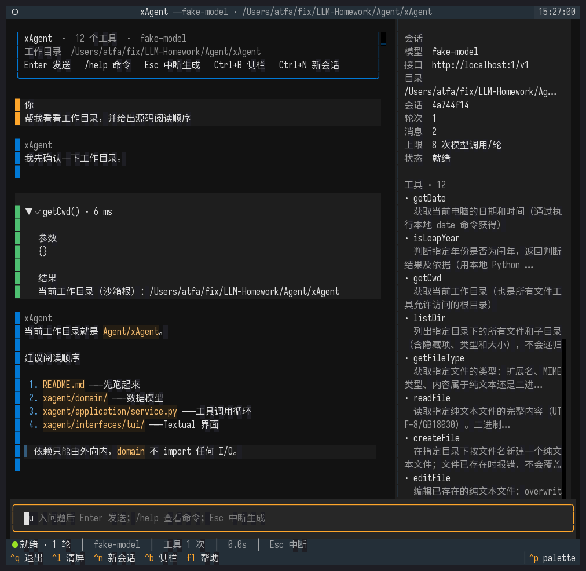
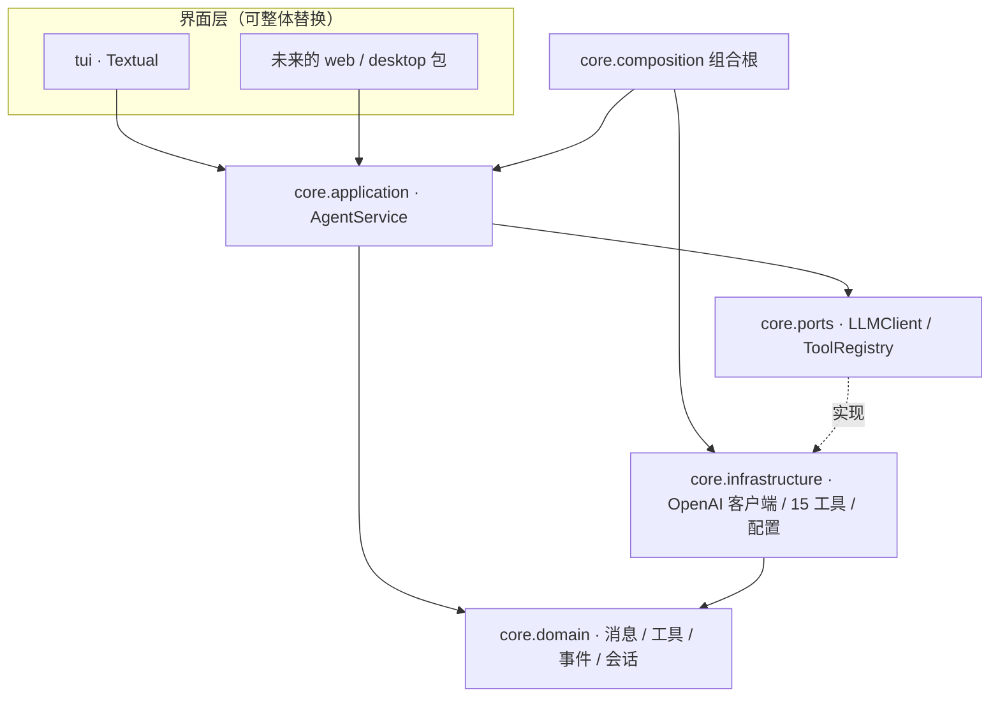

# xAgent · 分层可扩展的本地工具 Agent

> 由 `Agent/Practice02/chat-stream-tool-fileOps.py` 重构而来：保留原有的流式输出、
> 12 个本地工具、路径沙箱与工具调用循环语义，同时把 **core 与 UI 彻底分离**，
> 提供 Textual TUI，并为 Web / Desktop 等界面预留稳定契约。
> 后续新增了第 13 个工具 `webSearch`（百度千帆 AI 搜索）、
> 第 14 个工具 `fetchWeb`（网页正文提取）
> 与第 15 个工具 `runCli`（调用本机任意命令行程序）。



## 这一版解决了什么

| Practice02（单文件脚本） | xAgent |
| --- | --- |
| 配置、工具、HTTP、`print`、输入循环混在一个文件 | 顶层 `core` + `tui` 两个包；core 内部再按 domain / ports / application / infrastructure 分层 |
| UI 只能是终端 `print` | Textual TUI 消费事件流；Web / Desktop 照 `tui/` 参考实现新增即可 |
| 工具循环 `while True`，可能无限调用 | `max_iterations` 上限 + 可取消 |
| 工具逻辑与 `os` / 全局变量耦合 | 工具按领域拆分子包（`date_time/`、`file_ops/`），通过 `ToolRegistry` 端口注入 |
| 无测试 | 128 项测试：领域、沙箱、工具、循环、SSE、配置、分层约束、TUI 无头 |
| 无法替换模型客户端 | `LLMClient` 端口，OpenAI 兼容实现可替换 |

## 亮点

- **core 零 UI 依赖**：`AgentService` 只产出 `AgentEvent` 事件流，`tui/` 只是消费者之一；新增 Web / Desktop 前端时 core 一行不改。
- **依赖倒置**：应用层只面向 `LLMClient`、`ToolRegistry` 两个 Protocol 编程。
- **流式体验**：Markdown 增量渲染（80ms 节流）、工具调用卡片、状态栏、侧栏、自动滚动。
- **可中断**：`Esc` 取消当前轮；未完成的轮次不会写入历史。
- **安全默认**：`realpath` 沙箱、非空目录递归确认、工具输出回传截断、最大模型调用轮数。
- **可验证的架构**：`tests/test_layering.py` 把「依赖只能由外向内」变成 CI 断言。

## 快速开始

要求 Python 3.10+。

```bash
cd Agent/xAgent

# 推荐 uv；也可以 python -m venv .venv && .venv/bin/pip install -e ".[dev]"
uv venv .venv
uv pip install --python .venv/bin/python -e ".[dev]"

cp config.ini.example config.ini     # 填写 base_url / model / api_key
.venv/bin/python main.py             # 启动 TUI
```

其他入口：

```bash
.venv/bin/python main.py --list-tools             # 只列工具，不需要 API Key
.venv/bin/python -m xagent                        # 等价于 main.py
xagent                                            # pip install -e . 后的命令
```

配置也可完全走环境变量：`XAGENT_BASE_URL`、`XAGENT_MODEL`、`XAGENT_API_KEY`、
`XAGENT_WORKSPACE`、`XAGENT_MAX_ITERATIONS`、`XAGENT_TIMEOUT`、`XAGENT_TEMPERATURE`、
`XAGENT_THEME`、`XAGENT_CONFIG`，以及联网搜索的 `XAGENT_SEARCH_API_KEY`、
`XAGENT_SEARCH_ENDPOINT`、`XAGENT_SEARCH_SOURCE`、`XAGENT_SEARCH_TOP_K`、
`XAGENT_SEARCH_TIMEOUT`、`XAGENT_SEARCH_RECENCY`、`XAGENT_SEARCH_MODEL`。

## TUI

```text
┌ Header：xAgent — 模型 · 工作目录 ─────────────────────────────┐
├──────────────────────────────────┬───────────────────────────┤
│ ChatView                         │ Sidebar                   │
│  · 用户消息                      │  · 模型 / 接口 / 目录     │
│  · 流式 Markdown 回答            │  · 会话 id / 轮次 / 消息  │
│  · 可展开的工具卡片（参数/结果） │  · 15 个工具与说明        │
│  · 错误 / 中断提示               │                           │
├──────────────────────────────────┴───────────────────────────┤
│ Input：Enter 发送，Esc 中断                                  │
├──────────────────────────────────────────────────────────────┤
│ StatusBar：● 就绪 │ 模型 │ 工具次数 │ 耗时 │ Esc 中断        │
├──────────────────────────────────────────────────────────────┤
│ Footer：Ctrl+Q 退出  Ctrl+L 清屏  Ctrl+N 新会话 …            │
└──────────────────────────────────────────────────────────────┘
```

快捷键：

| 按键 | 作用 |
| --- | --- |
| `Enter` | 发送（输入框中） |
| `Esc` | 中断当前生成 |
| `Ctrl+Q` / `Ctrl+C` | 退出 |
| `Ctrl+L` | 清屏（保留历史） |
| `Ctrl+N` | 新会话（重置历史） |
| `Ctrl+B` | 显示 / 隐藏侧栏 |
| `F1` | 帮助 |

斜杠命令：`/help`、`/clear`、`/new`、`/tools`、`/cwd`、`/model`、`/quit`。

## 架构一览

```text
Agent/xAgent/
├── main.py                     # 便捷入口
├── pyproject.toml              # 依赖 / 打包 / pytest / pyright / ruff
├── config.ini.example
├── xagent/
│   ├── __main__.py             # python -m xagent
│   ├── entrypoint.py           # 参数解析，启动 TUI（唯一同时接触 core 与界面层的地方）
│   ├── core/                   # Agent 全部核心，与任何界面无关
│   │   ├── composition.py      #   组合根：唯一装配具体实现的地方
│   │   ├── domain/             #   纯领域模型（零 I/O、零第三方依赖）
│   │   │   ├── messages.py     #     ChatMessage / Role / Turn
│   │   │   ├── tools.py        #     ToolDefinition / ToolCall / ToolOutcome
│   │   │   ├── events.py       #     模型流事件（TextDelta / ToolCallDelta …）
│   │   │   ├── accumulator.py  #     把分块 tool_calls 合并成完整调用
│   │   │   ├── conversation.py #     只保留最终问答的历史
│   │   │   └── errors.py
│   │   ├── ports/              #   抽象协议（依赖倒置）
│   │   │   ├── llm.py          #     LLMClient.stream_chat(...)
│   │   │   └── tools.py        #     ToolRegistry.definitions() / invoke()
│   │   ├── application/        #   用例编排
│   │   │   ├── service.py      #     AgentService：模型 ⇄ 工具循环
│   │   │   ├── events.py       #     UI 稳定契约（AgentEvent）
│   │   │   ├── session.py      #     ChatSession
│   │   │   ├── settings.py     #     AgentSettings（system prompt / 上限）
│   │   │   └── runtime.py      #     AgentRuntime + RuntimeInfo
│   │   └── infrastructure/     #   端口实现
│   │       ├── config.py       #     ini + 环境变量
│   │       ├── llm/            #     SSE 解析 + 线程桥
│   │       │   └── openai_compatible.py
│   │       └── tools/          #     注册表 + 按领域拆分的工具子包
│   │           ├── catalog.py  #       装配 15 个工具
│   │           ├── registry.py #       参数解析、线程执行、错误归一化
│   │           ├── date_time/  #       getDate / isLeapYear
│   │           ├── file_ops/   #       Sandbox + 10 个文件工具
│   │           ├── web_search/ #       webSearch（百度千帆 AI 搜索）
│   │           ├── web_fetch/  #       fetchWeb（curl + trafilatura 网页正文）
│   │           └── run_cli/    #       runCli（subprocess 调用本机 CLI）
│   └── tui/                    # Textual 界面（core 的一个消费者，可整体替换）
│       ├── app.py              #   App / 事件渲染 / 斜杠命令
│       ├── formatting.py       #   跨 UI 复用的展示格式化
│       ├── help_screen.py      #   帮助弹窗
│       └── widgets/            #   ChatView / Sidebar / StatusBar
├── tests/                      # 128 项测试，含分层约束与 TUI 冒烟
├── tools/                      # 开发工具：自动演示 + 预览截图
└── docs/
    ├── tui-preview.png
    └── ADDING_A_UI.md          # 新增 Web / Desktop 界面的操作指南
```

依赖方向（**只能由外向内**）：



| 层 | 可以依赖 | 职责 | 禁止 |
| --- | --- | --- | --- |
| `core/domain` | 仅标准库 | 数据模型、不变量、纯算法 | 任何 I/O、网络、UI |
| `core/ports` | `core/domain` | Protocol 契约 | 具体实现 |
| `core/application` | `core/domain`、`core/ports` | 用例编排、事件流 | 具体 SDK / UI |
| `core/infrastructure` | `core/domain`、`core/ports` | 网络、文件、配置适配 | 引用 UI |
| `tui`（及未来的 web / desktop） | `core/application`、`core/domain`、`core/ports` | 渲染与输入 | import `core/infrastructure`、直接调 HTTP / 文件工具 |
| `core/composition` / `entrypoint` | 任意（除 core 反向依赖界面） | 装配与启动 | 承载业务逻辑 |

> 规则不是口号：`tests/test_layering.py` 用 AST 扫描所有 import，违反即失败。

详见 [ARCHITECTURE.md](ARCHITECTURE.md)。

## 事件契约（UI 的唯一入口）

TUI 不接触 SSE、HTTP 或工具实现，只消费（`tui/` 是参考实现，Web / Desktop 同理）：

| 事件 | 时机 | UI 典型动作 |
| --- | --- | --- |
| `TurnStarted` | 一轮开始 | 创建用户消息 |
| `IterationStarted` | 第 N 次模型调用 | 状态栏「生成中 N/上限」 |
| `AssistantTextDelta` | 正文增量 | 追加流式 Markdown |
| `IterationCompleted` | 单次模型调用结束 | 收尾当前回答块，展示工具计划 |
| `ToolCallStarted` | 工具开始 | 新建「运行中」卡片 |
| `ToolCallFinished` | 工具结束 | 卡片改为成功/失败 + 耗时 |
| `TurnCompleted` | 成功结束 | 状态栏就绪、刷新侧栏 |
| `TurnFailed` | 失败结束 | 错误提示 |

取消不以事件表达：`run_turn` 被取消时直接抛 `CancelledError`，由 UI 决定提示方式。

## 工具（15 个）

| 工具 | 说明 |
| --- | --- |
| `getDate` | 本机 `date` 命令；命令不可用时回退 Python 时间 |
| `isLeapYear` | Python `calendar` 精确判断 |
| `getCwd` | 沙箱根目录 |
| `listDir` | 列出目录（含隐藏项、类型、大小；最多 200 条） |
| `getFileType` | 扩展名 / MIME / 文本或二进制 / 大小 |
| `readFile` | 读取纯文本（UTF-8 / GB18030，≤256KB） |
| `createFile` | 新建文件，不覆盖 |
| `editFile` | `overwrite` / `append`，不创建新文件 |
| `createDir` | 多级创建，已存在报错 |
| `deleteDir` | 非空目录必须 `recursive=true` |
| `deleteFile` | 删除单个文件 |
| `renamePath` | 原地改名，不移动、不覆盖 |
| `webSearch` | 联网搜索（百度千帆 AI 搜索），返回标题 / 链接 / 日期 / 摘要 |
| `fetchWeb` | 抓取网页并提取正文为 Markdown（curl + trafilatura） |
| `runCli` | 调用本机任意命令行程序，返回 stdout / stderr / 退出码（`subprocess`，非 shell） |

沙箱规则：所有路径先 `expanduser` 再 `realpath`（解析符号链接），必须落在工作目录内；
`../`、绝对路径越界、指向外部的软链接都会被拒绝。二进制文件与超大文件拒绝读取。

### 联网搜索（webSearch）

`webSearch` 调用**百度千帆 AI 搜索**
（[接口文档](https://cloud.baidu.com/doc/qianfan-api/s/Hmbu8m06u)），
把「实时全网信息」变成模型可以调用的 function call：

```jsonc
{
  "name": "webSearch",
  "parameters": {
    "query":   "搜索关键词或问题",
    "top_k":   5,          // 可选，1~20
    "recency": "month"     // 可选，week / month / semiyear / year
  }
}
```

返回给模型的是可读文本：每条结果包含标题、链接、来源站点、发布日期与摘要
（单条摘要截断到 600 字，避免挤占上下文）。

两种服务模式由配置决定：

| 配置 | 模式 | 返回 |
| --- | --- | --- |
| `[search] model` 留空（默认） | 百度搜索 | 只有网页结果，**由本 Agent 自己的大模型阅读并归纳** |
| `[search] model = <千帆已开通的模型>` | 智能搜索生成 | 网页结果 + 千帆模型写好的总结 |

在 `config.ini` 的 `[search]` 段配置（也可用环境变量覆盖）：

```ini
[search]
baidu_qianfan_api_key = bce-v3/ALTAK-xxx/xxx   # 必填，否则 webSearch 会提示「未配置 API Key」
search_source = baidu_search_v2                  # v1 / v2，v2 数据更丰富
top_k = 5                                         # 每次搜索返回条数（1~20）
timeout = 30                                      # 搜索超时（秒）
recency =                                         # 默认不按时间过滤
model =                                           # 留空 = 百度搜索模式
```

| 环境变量 | 对应配置 |
| --- | --- |
| `XAGENT_SEARCH_API_KEY` | `baidu_qianfan_api_key` |
| `XAGENT_SEARCH_ENDPOINT` | `endpoint` |
| `XAGENT_SEARCH_SOURCE` | `search_source` |
| `XAGENT_SEARCH_TOP_K` | `top_k` |
| `XAGENT_SEARCH_TIMEOUT` | `timeout` |
| `XAGENT_SEARCH_RECENCY` | `recency` |
| `XAGENT_SEARCH_MODEL` | `model` |

未配置 Key 时 `webSearch` 仍会出现在工具列表里，但调用会得到一条可读提示
（而不是静默失败），便于定位问题。

### 网页正文提取（fetchWeb）

`fetchWeb` 把「打开一个网页读正文」变成模型可调用的 function call：

```jsonc
{
  "name": "fetchWeb",
  "parameters": {
    "url": "https://example.com/article"   // 必填，http/https
  }
}
```

实现方式：用 `subprocess` 以**参数列表**（非 `shell=True`）调用本地 `curl` 抓取 HTML，
再用 [trafilatura](https://github.com/adbar/trafilatura) 提取正文并转换为 Markdown，
尽量保留标题、段落、列表、表格与链接，去掉导航栏、广告、页脚等无关内容，
以减少回传模型的上下文 Token。

返回给模型的是「原始 URL + Markdown 正文」。以下情况会返回可读错误
（而不是中断对话）：URL 非法、curl 不可用、访问失败或超时、HTML 解析失败、
正文无法提取。该工具依赖 `trafilatura`（已列入项目依赖）。

### 运行本地命令行（runCli）

`runCli` 把「在本机执行一条命令」变成模型可调用的 function call，
让 Agent 能借助已安装的 CLI（`git`、`python3`、`grep`、`ffmpeg` …）完成任务：

```jsonc
{
  "name": "runCli",
  "parameters": {
    "command": "git",                     // 必填，程序名或可执行文件路径
    "args": ["status", "--short"],        // 可选，参数列表（不含程序名本身）
    "timeout_seconds": 30                 // 可选，默认 30，最大 600
  }
}
```

实现要点：

- **不做 shell 拼接**：程序名与参数被拼装成列表，用 `subprocess.run(..., shell=False)`
  直接执行；管道 `|`、重定向 `>`、通配符 `*`、`$VAR` 等 shell 语法**不会**被解释，
  需要时请显式调用 `sh -c` 并把整条命令作为参数传入。这样既避免了命令注入，行为也可预期。
- **执行目录**：命令的工作目录是 Agent 的工作目录（沙箱根），与 `getCwd` 一致。
- **回传内容**：返回命令、退出码、stdout 与 stderr 三段文本。**非零退出码不会被视为工具失败**，
  而是原样返回，让模型结合 stderr 自行判断并决定下一步。
- **超时**：默认 30 秒，可由模型在 1~600 秒内调整；超时会终止命令，并返回超时前已产生的输出。
- **输出截断**：stdout / stderr 各保留首尾、最多 20000 字符，中间省略的部分会明确标注
  （例如「中间省略 12345 个字符，共 67890 字符」），避免大量终端输出挤占上下文。
- **失败归一化**：只有参数非法、程序不存在（`FileNotFoundError`）或无法启动时才返回错误，
  由 `ToolRegistryImpl` 统一转成 `ToolOutcome.failed` 回传模型。

> ⚠️ 教学取舍：本阶段**故意不实现**命令白名单、黑名单或审批机制，命令以运行 xAgent
> 的当前用户权限执行。请仅在受控的教学实验环境中使用；生产场景务必补充权限约束与人工确认。

## 配置

`config.ini`：

```ini
[llm]
base_url = https://api.openai.com/v1
model = gpt-4o-mini
api_key = sk-...

[agent]
max_iterations = 8              # 单轮最多模型调用次数
max_tool_output_chars = 30000  # 工具结果回传模型的上限
# workspace = .
# theme = textual-dark

[search]
baidu_qianfan_api_key = bce-v3/ALTAK-xxx/xxx   # 可选：联网搜索工具
```

`config.ini` 已被 `.gitignore` 忽略；仓库里只提交模板。

## 扩展

**新增界面（Web / Desktop）**

1. 复用 `composition.build_runtime()` 得到 `AgentRuntime`；
2. 消费 `agent.run_turn(session, prompt)` 的 `AgentEvent` 流；
3. 渲染 / 转发事件，输入侧调用 `run_turn` 即可。

完整示例（FastAPI SSE、PySide6）见 [docs/ADDING_A_UI.md](docs/ADDING_A_UI.md)。

**新增工具**

1. 在 `xagent/core/infrastructure/tools/` 下按领域建子包（参考 `date_time/`、`file_ops/`），写 `ToolDefinition` + 同步 handler；
2. 在 `catalog.build_tool_registry()` 中注册；
3. 需要沙箱时注入 `Sandbox`（`file_ops/sandbox.py`），不要自己拼接路径。

**新增模型厂商**

实现 `xagent.core.ports.llm.LLMClient`（`async def stream_chat(...)` 异步生成器），
在 `core.composition.build_runtime()` 中替换实现即可；应用层与所有界面不需要改。

> `core/composition.py` 是唯一允许同时 import `core.application` 与 `core.infrastructure` 的地方。
> 新增依赖时先问：这个 import 属于哪一层？

## 测试与质量

```bash
.venv/bin/python -m pytest             # 128 passed
.venv/bin/python -m pyright            # 0 errors（使用项目 .venv）
```

覆盖范围：

- `test_domain.py`：消息不变量、wire 格式、分块工具调用合并、会话历史
- `test_sandbox.py`：越界、外部软链接、编码探测
- `test_file_tools.py`：10 个文件工具的完整生命周期与破坏性操作保护
- `test_search_tools.py`：`[search]` 配置解析、搜索请求体、响应解析与错误归一化
- `test_fetch_tools.py`：`fetchWeb` 参数校验、curl 调用（非 shell）、正文提取与各类失败归一化
- `test_run_cli_tools.py`：`runCli` 参数校验、非 shell 参数列表、stdout/stderr/退出码格式、超时与输出截断
- `test_agent_service.py`：工具循环、历史只存最终问答、最大轮数、流失败、取消、截断
- `test_sse_decoder.py`：SSE 分块、`[DONE]`、错误载荷、畸形数据
- `test_config.py`：ini / 环境变量优先级、缺失项与非法值提示
- `test_layering.py`：AST 依赖方向断言（tui 只依赖 core 契约、core 不依赖 tui、core 内部由外向内）+ 领域层纯净性
- `test_tui.py`：无头 TUI 渲染、工具卡片、Esc 取消、帮助、斜杠命令、新会话

开发辅助（需要 `pyte` + `Pillow`）：

```bash
.venv/bin/python tools/capture_preview.py   # 重新生成 docs/tui-preview.png
```

预览采用「伪终端 + pyte + PIL」渲染，避开 Rich SVG 导出对 CJK 宽度的已知问题。

## 与 Practice02 的对应关系

| Practice02 | xAgent |
| --- | --- |
| 模块级 `cfg[...]` 读取 | `core/infrastructure/config.py` → `AppConfig` |
| `tools = [...]` 大列表 | 各工具子包（`date_time/`、`file_ops/`）的 `ToolDefinition` |
| `resolve_path()` / `WORKSPACE` | `core/infrastructure/tools/file_ops/sandbox.py` → `Sandbox` |
| `tool_*` 函数 | `file_ops/file_tools.py` / `date_time/datetime_tools.py` |
| `run_tool()` | `ToolRegistryImpl.invoke()`（异步、线程池、错误归一化） |
| `chat_stream()` | `OpenAICompatibleClient` + `ChatCompletionDecoder` |
| `while True` 工具循环 | `AgentService.run_turn()` + `max_iterations` |
| `history` | `core/domain/conversation.py` → `Conversation` |
| `print()` 输出 | `AgentEvent` → 界面层渲染 |
| `input()` 主循环 | `tui/app.py` |

## 已知限制

- 会话仅存在内存中，进程退出即丢失；未做多会话持久化。
- 工具串行执行；并行调用需在应用层增加调度与事件序号。
- 未统计 token 用量；长对话不会自动裁剪历史。
- 推理类模型（如 `deepseek-reasoner`）的 `reasoning_content` 暂不展示，只渲染最终 `content`。
- `--list-tools` 不需要 API Key，但 TUI 启动需要有效配置。
- `getDate` 依赖系统命令；无 `date` 时回退到 Python 本地时间。
- 仓库根目录的 `pyrightconfig.json` 仅用于让编辑器使用 `Agent/xAgent/.venv`，
  如影响其它项目可按需删除或调整 `include`。
